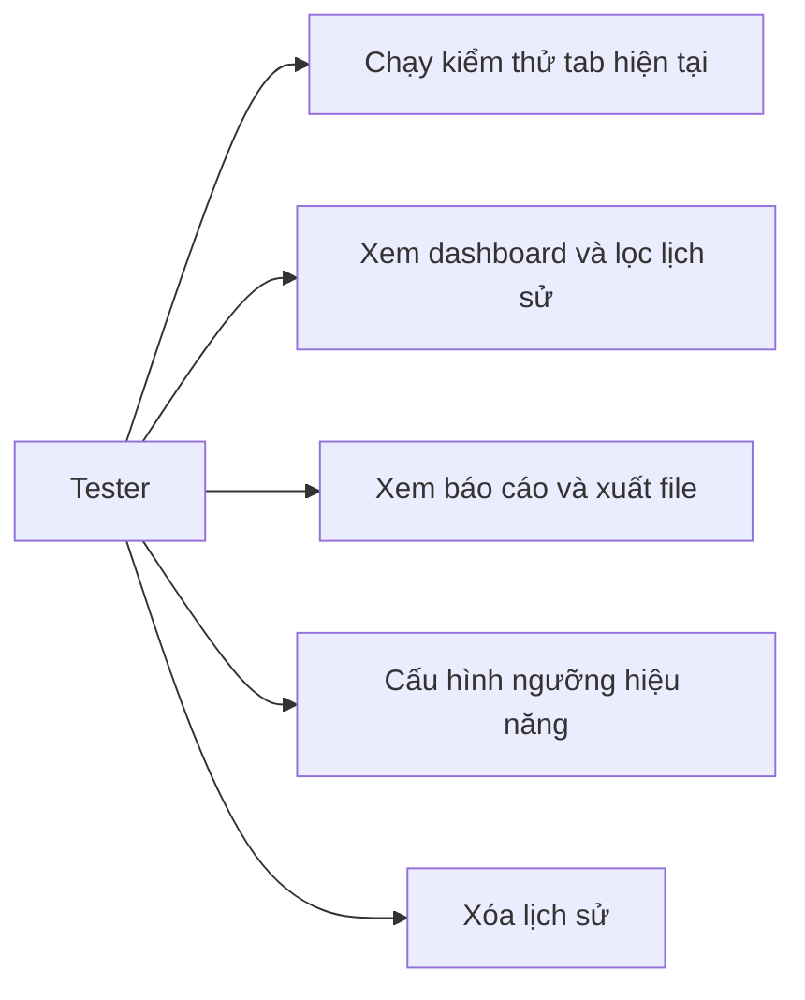

# Use case

**UC1 — Chạy kiểm thử:** Tester mở website được phép, bật popup, xác nhận checkbox, chọn nhóm/mức, bắt đầu. Hệ thống inject collector, chạy rule, tùy chọn probe HTTP và axe-core, lưu kết quả.

**UC2 — Dashboard:** Tester mở trang extension, xem thống kê và bảng lịch sử.

**UC3 — Báo cáo:** Tester lọc finding, tải JSON/HTML hoặc in.

**Ngoại lệ:** URL không HTTP(S), tab `chrome://`, từ chối quyền, hủy phiên, service worker dừng giữa chừng.
